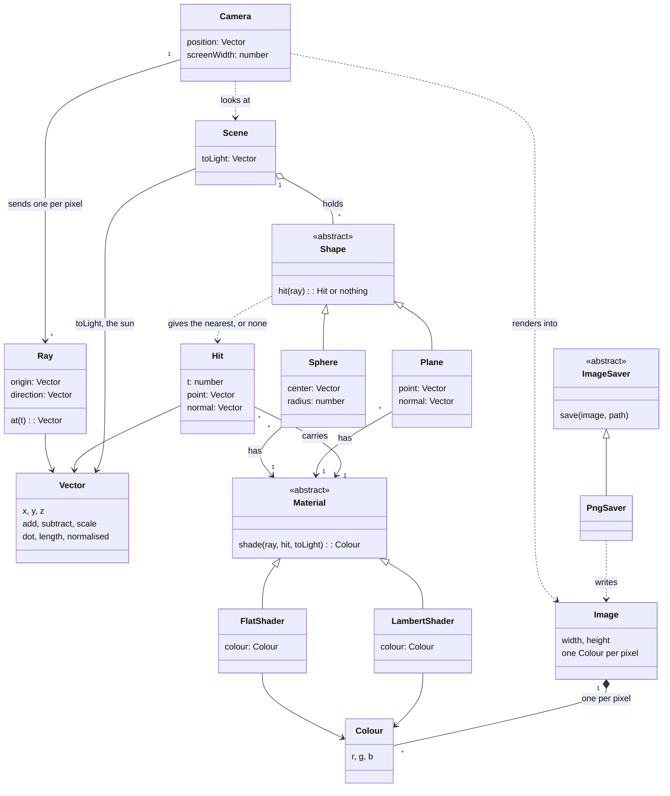

# Domain model

A map of the concepts of the client's domain and how they relate, as our code represents them at
milestone m1. It is a class diagram without methods, except for `Vector`, where the operations are
the maths of the domain.

The client's words: *a camera sends a ray through each pixel. A ray has an origin and a direction.
We ask the shapes of the scene whether the ray hits them. A shape has a material. The nearest hit
gives the colour of the pixel, lit by the sun. When every pixel has a colour, we have an image, and
we save it to a file.*

## What each thing knows, and what you can ask it

| Entity | Knows | You can ask it |
|---|---|---|
| Vector | x, y, z | Add, subtract, scale, dot, length, normalise |
| Colour | r, g, b, from 0 to 1 | Its three numbers |
| Ray | Origin, direction | Where are you at t? |
| Hit | How far along the ray (t), the point, the unit normal, the material | Its four values |
| Material | A law that gives a colour | What colour here, given the ray, the hit and the direction to the sun? |
| Shape | Nothing: it is a promise | Does this ray hit you, and where? (t > 0, unit normal, or nothing) |
| Sphere | Centre, radius, material | The same as any Shape |
| Plane | A point, a unit normal, material | The same as any Shape |
| Scene | The shapes and the direction to the sun | What is the nearest hit of this ray? |
| Camera | Position, screen width | What is the ray for this pixel? Draw this scene in an image of this size |
| Image | Width, height, one Colour per pixel | Set a pixel, read a pixel |
| ImageSaver | Nothing: it is a promise | Save this image to this path |

## Links to read

- **A shape has a material.** `Sphere` and `Plane` each hold one, and give it to their `Hit`.
  Several shapes can share the same material. See ADR 0007.
- **A scene holds the shapes and the sun.** `trace` and the camera know a `Scene`, and the scene
  knows "a Shape": only `main` names `Sphere` and `Plane`.
- **A ray hits shapes, and the scene keeps the nearest.** The nearest is the hit with the smallest
  `t`, which works because every shape keeps the same promise.
- **The colour of a pixel** is decided by `Camera::trace`: the material of the nearest hit.
- **Saving an image** is not a method of `Image`: a saver saves it. `Image` holds pixels and does not
  know about PNG.
- **A colour is not a vector.** See ADR 0005.
- **Where the axes point and where the pixels start.** See ADR 0009.
